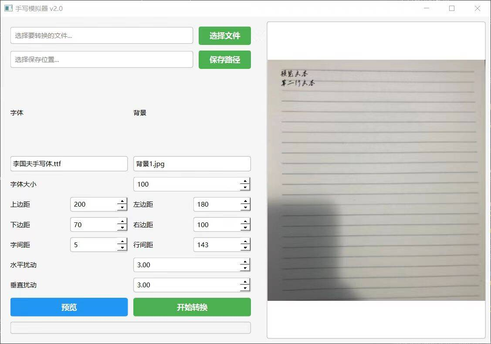

# Handwriter

一个将 `.txt` / `.doc` / `.docx` 文本转换为手写风格图片的桌面小工具。程序基于 `PyQt6 + Pillow`，支持字体、背景、边距、字距、行距等参数调整，并提供多页预览与导出。



## 主要功能

- 支持拖拽或选择文本文件导入
- 支持自定义字体、背景图和排版参数
- 支持预览翻页
- 支持长文本自动分页导出
- 支持生成手写风格 PNG 图片

## 本次修复

这次主要修复了文本排版和预览一致性问题：

- 修复按估算字符数强制换行导致的文本截断问题，改为基于真实字体宽度换行
- 修复导出分页与预览分页逻辑不一致的问题，统一为同一套排版流程
- 修复原始文本包含空行时的间距异常问题
- 修复“一行一个换行”的 TXT 被误判为段落、导致中间额外空很多行的问题
- 为 `.txt` 文本增加多编码回退读取，降低乱码和读取失败概率

## 运行环境

- Python 3.10+
- Windows
- PyQt6
- Pillow
- docx2txt

安装依赖：

```bash
pip install PyQt6 Pillow docx2txt
```

## 使用方法

```bash
python write.py
```

启动后按下面流程操作：

1. 选择输入文件
2. 选择输出目录
3. 选择字体和背景
4. 调整字体大小、边距、字距、行距等参数
5. 点击“预览”检查效果
6. 点击“开始转换”导出结果

导出结果会保存在：

```text
handwritten_<输入文件名>/page_001.png
handwritten_<输入文件名>/page_002.png
...
```

## 目录结构

```text
handwriter/
├─ Background/     背景图片
├─ fonts/          字体文件
├─ Parameter/      参数配置
├─ config.json     基础配置
├─ write.py        主程序
└─ README.md
```

## 参数说明

- `font_size`：字体大小
- `line_spacing`：行距
- `word_spacing`：字间距
- `left_margin / right_margin / top_margin / bottom_margin`：页边距
- `perturb_x_sigma / perturb_y_sigma`：文字抖动幅度

## 资源说明

- 字体文件放在 `fonts/`
- 背景图片放在 `Background/`
- 参数模板放在 `Parameter/`

程序启动时会自动读取这些目录中的资源。

## 当前说明

- 当前重点修复的是换行、分页、空行保留和预览一致性
- 仓库中包含部分示例字体、背景和参数模板，可直接使用
- 如需更换手写风格，建议优先替换字体与背景图
